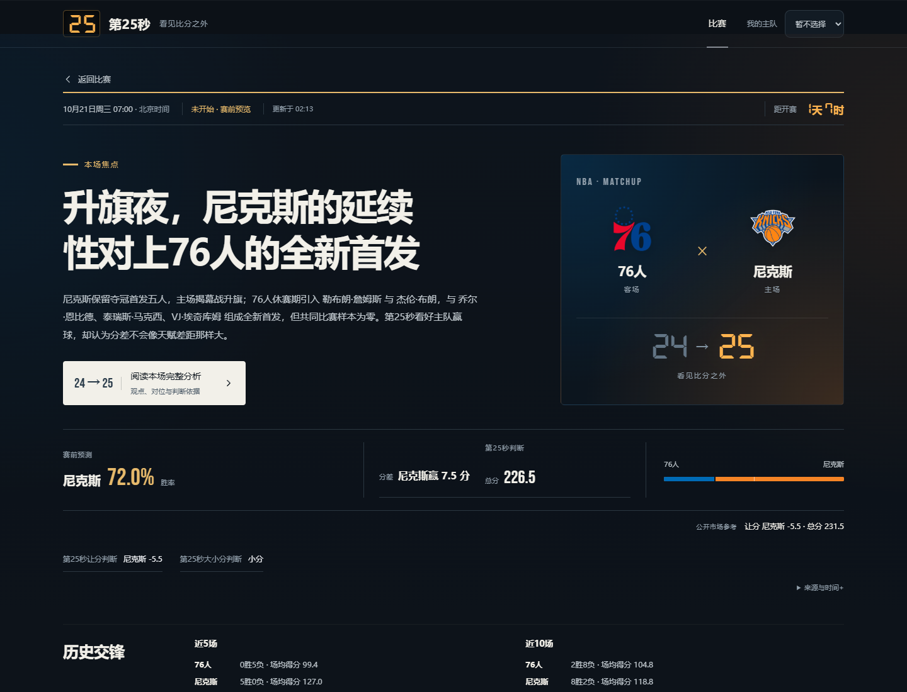
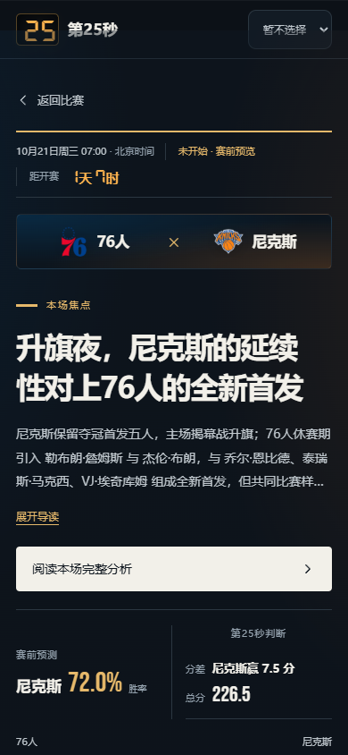

# CourtVision · 第25秒

[网站](https://nba.weitao.si/) · [架构](docs/ARCHITECTURE.md) · [评测记录](evaluation/reports/FINAL_AI_HANDOFF.md) · [发布说明](docs/PUBLIC_DEPLOYMENT.md)

第25秒是一个 NBA 比赛分析项目。它把球队和球员历史数据、赛前情报、独立预测与市场参考整理成比赛分析，比赛结束后再对照赛前判断复盘。页面先呈现本场值得关注的问题，再给出胜率、分差、总分和依据。

报告在本地生成，公开网站读取已发布的结果。浏览页面不会调用模型。

<!-- daily-picks:start -->
## 明日预测名单 · 2026-10-29

北京时间。这里只列人工选定的比赛；名单更新不会触发 Research 或模型生成。

明日尚无已选定且日期匹配的比赛。不沿用昨日名单，也不自动挑选其他比赛。

每日计划于北京时间 12:10 更新，也会随选场或公开报告变动更新。
选场记录：[daily_picks.json](config/daily_picks.json)。正式报告的资料时间单独列出，名单刷新不代表情报已刷新。
<!-- daily-picks:end -->



揭幕战76人客场对尼克斯的赛前页面。首发、伤病和球员解读按已保存版本展示，缺资料时保留未知状态。

<details>
<summary>手机页面</summary>



</details>

## 本地运行

展示站只需要 Python 3.12+，不需要数据库或 API Key：

```sh
python scripts/build_public_site.py
python -m http.server 8000 --directory _site
```

打开 `http://localhost:8000`。前端使用原生 HTML、CSS 和 JavaScript，没有额外构建工具；比赛详情使用 hash 路由，可以直接打开或刷新。

公开仓库带有少量比赛样例。完整 Agent、原始数据、数据库和模型文件仍在本地，不能仅凭公开仓库复现全部生产流程。`requirements.txt` 保留了原工程的依赖快照，运行展示站不必安装它。

## 分析流程

```text
历史数据与当前名单 → 赛前 Research → 独立预测 → 市场复核
                                             ↓
赛后事实 → 对照赛前版本复盘 ← 保存 Prediction Version ← 编辑与事实检查
```

独立预测阶段不看盘口。市场复核保留独立结果和修改原因，编辑阶段读取锁定的预测数值。每次正式预测保存比赛身份、输入截止时间和内容哈希，后续更新新增版本，不覆盖旧版本。

赛后先由程序对齐比分、胜负、分差和总分，再由独立的写作流程生成复盘。历史球员表现用于能力背景，不能直接证明当前所属球队、出战状态或确认首发。

完整模块关系见[架构说明](docs/ARCHITECTURE.md)。

## 模型评测

评测使用冻结的历史输入，保存请求、失败尝试和修复记录，分别统计执行可靠性、结构合规和文章质量。下面是 2026-10-13 的 V1 记录，详细配置和限制见[实验交接](evaluation/reports/FINAL_AI_HANDOFF.md)。

| 项目 | 结果 | 统计口径 |
|---|---|---|
| 历史输入 | 1,231 场及对应匿名版本 | 两套视图来自同一批比赛 |
| 静态用例 | 300 个，覆盖30队 | 静态检查，没有执行300次模型生成 |
| 黄金评测集（Golden） | 20 场，覆盖30队 | 12个代表样本、8个挑战样本，存在来源重叠 |
| 生成与验收 | 15篇文章，14/20条链路合格 | 5次生成失败、1篇暂缓验收；这里衡量执行情况 |
| DeepEval 自动检查 | 128/160项通过 | 每场8项，全部通过的样本为6/20 |
| 模型裁判 | 14份有效评审 | 同模型家族，尚未经过人工校准 |
| 人工标注 | 0条 | 工作台已准备，标注未完成 |
| 归档回归 | 47/47符合预期 | 20个样本，27条接受、20条拒绝 |
| Phoenix 追踪 | 85个 span | 实验请求与阶段记录，不代表生产监控覆盖 |

原始响应、解析和 schema 合规分别为20/20、18/20、7/20；有限修复恢复了2/5个失败样本。评价标准包含5项硬门槛和6项软指标。

这轮使用历史回放适配器，`production_equivalence=False`，Pure 数值基线不可用。14/20是链路验收结果，不能当作预测命中率；模型裁判的评分也还缺少人工验证。[错误案例](evaluation/finalization/RCA_STORIES.md)记录了身份范围、Decimal 校验，以及15篇文章中只有14篇通过验收的原因。自动最终版调度仍需真实运行验证。

## 预测模型实验

[LightGBM、XGBoost 与 ARIMA 实验](experiments/predictive_benchmark/README.md)比较了按时间划分的表格预测模型，以及逐场滚动的球队得分预测。早停只使用训练阶段数据；[结果记录](experiments/predictive_benchmark/RESULTS.md)包含3类表格任务和492个球队单场时间序列目标。

这些是离线实验，没有替换生产模型。公开内容包括代码、固定配置和汇总结果，原始数据与逐场输出未分发。

## 代码入口

| 路径 | 内容 |
|---|---|
| `v2/pregame_system/` | Research、预测、事实检查与版本 |
| `v2/postgame_system/` | 赛果对齐、误差结算与复盘 |
| `v2/frontend/` | 页面、本地服务与任务运行 |
| `agent/skills/` | 各阶段的分析和写作约定 |
| `evaluation/` | 冻结输入、评测标准、裁判、回归与追踪 |
| `experiments/predictive_benchmark/` | 离线预测模型实验 |
| `src/`、`analysis_v1/` | 早期数据处理和建模代码 |
| `public_data/` | 已脱敏的比赛展示数据及 schema |
| `publish_game.py`、`web/`、`scripts/` | 导出、静态读取、构建和发布检查 |

`public_data` 是按允许字段导出的展示数据，保留原版本ID及哈希，但不包含完整私有 payload。部分样例含人工编辑，具体边界见[公开数据约定](docs/PUBLIC_DATA_CONTRACT.md)。

## 检查与发布

公开站测试需要 Python 和 Node.js：

```sh
python -m unittest discover -s tests/public -v
python scripts/check_public_release.py --history
node --check web/static-data.js
```

离线合同回归另装 `requirements-evaluation.txt`：

```sh
python -m pip install -r requirements-evaluation.txt
python -m pytest evaluation/candidate_v4/test_contracts_v4.py evaluation/candidate_v2/test_contracts.py -k "not baseline"
```

排除的 baseline 检查依赖未公开的冻结语料，不能计为通过。

新增比赛时，先在本地生成并保存正式版本，再运行 `publish_game.py` 导出。导出只读取已保存内容，不重新运行 Research 或模型。GitHub Actions 检查通过后构建 `_site`，部署到 Pages；完整操作见[发布说明](docs/PUBLIC_DEPLOYMENT.md)。

代码采用 MIT 许可。NBA／ESPN 数据、队标、新闻和字体等材料遵守各自的使用条款，见[第三方说明](THIRD_PARTY_NOTICES.md)。
